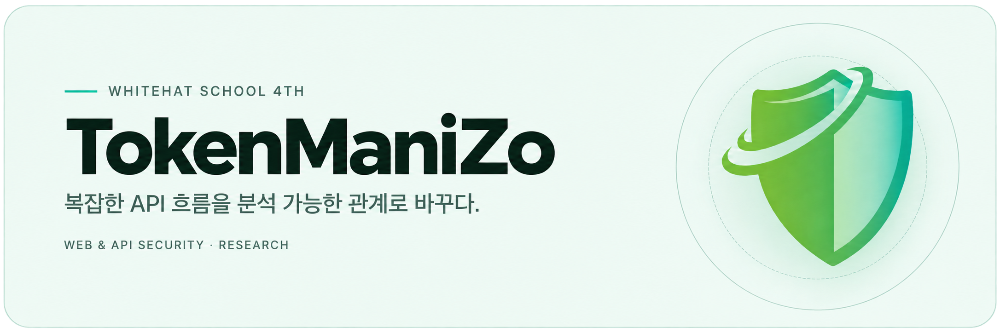

  

---

## 👋 About Us

**TokenManiZo(TMZ)**는 화이트햇스쿨 4기에서 결성된 웹·API 보안 프로젝트 팀입니다.

기존 보안 점검에서 복잡한 API 호출 흐름과 접근통제 관계를 분석하는 데 발생하는 어려움을 개선하고자 FlowScope를 개발했습니다.
개발한 도구를 오픈소스 취약점 분석과 블랙박스 버그바운티에 적용했으며, API 인가 취약점 분석 방법론에 관한 학술 연구도 수행했습니다.

---

## 🚀 FlowScope

### 프로젝트 주제

**AI·API 플로우 취약점 분석 — 웹 API 진단의 IDA를 만들다**

**FlowScope**는 Burp Suite 기반 웹·API 탐색 및 접근통제 분석 도구입니다.

수동 점검, OWASP ZAP, LLM 기반 탐색 결과를 통합하고, 신원–API–객체 간 관계를 시각화하여 탐색 누락 구간과 IDOR·BOLA·BFLA 등 인가 취약점 후보의 분석 및 검증을 지원합니다.

  
  &ensp;
  
  &ensp;
  

### 핵심 기능

| 기능 | 설명 |
|:---|:---|
| **API 탐색 결과 통합** | 수동 점검·스캐너·LLM의 API 탐색 결과를 수집하고 공통 형식으로 정규화 |
| **미점검 구간 식별** | 탐색 방식별 API 커버리지를 비교해 미점검 영역 파악 |
| **신원–API–객체 시각화** | 계정별 API 호출과 객체 접근 관계를 그래프로 표현 |
| **판정 매트릭스** | 계정·역할·객체 소유 관계에 따른 접근 권한 비교·분석 |
| **계정 간 교차 검증** | 동일 API·객체에 대한 계정별 접근 결과를 비교해 인가 취약점 후보 검증 지원 |
| **재전송 기반 분석** | 판정 매트릭스·그래프 정보를 바탕으로 요청을 자동 재전송하고, 응답을 비교해 인가 취약점 후보 분석 |

[**FlowScope Repository →**](https://github.com/TokenManiZo/flowscope)

---

## 🏆 Achievements (추후 업데이트 예정)

| 구분 | 주요 성과 |
|:---|:---|
| **Vulnerability Research** | 추후 업데이트 예정 |
| **CVE** | 추후 업데이트 예정 |
| **Bug Bounty** | 추후 업데이트 예정 |
| **Publication** | 한국정보보호학회 CISC-W 2026 논문 채택 (Accepted) |

---

## 👥 Team Members

### Mentor & Project Leader

| Mentor | Project Leader (PL) |
| :--- | :--- |
| [김주원](https://github.com/arrester) | [이상현](https://github.com/isanghyeon) |

### Mentees

[김경훈](https://github.com/J0hnathanKim) · [김광원](https://github.com/gwangwon0807) · [김태훈](https://github.com/xo0102) · [서승린](https://github.com/garry15907) · [최원우](https://github.com/choewonwoo1817) · [심지운](https://github.com/simjiun) · [전오규](https://github.com/Kamba-netizen) · [김태연](https://github.com/t-211)
